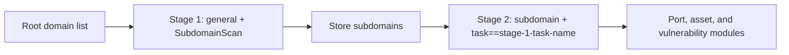

---

## name: scopesentry-mcp
description: Manage the ScopeSentry security scanning platform through MCP (projects, tasks, templates, assets, and nodes). Use when users mention ScopeSentry, MCP, API keys, scan tasks, or asset queries.

# ScopeSentry MCP Guide

For users of a **deployed ScopeSentry instance**. Connect through Cursor (or another MCP client); local source code is not required.

## 1. Preparation

### 1.1 Confirm service access

- Default web interface: `http://<host>`
- MCP endpoint: `http://<host>/mcp` (if a reverse proxy or frontend proxy is used, use the actual `/mcp` address)

### 1.2 Create an API key

1. Sign in to the ScopeSentry web interface.
2. Open the **API Key** management page and create a key (or use an administrator-provided endpoint).
3. Save the returned `ssk_...` string (**it is shown only once**).

### 1.3 Configure Cursor MCP

Cursor → Settings → MCP → Add server:

```json
{
  "mcpServers": {
    "scopesentry": {
      "url": "http://<your-host>:8082/mcp",
      "headers": {
        "X-API-Key": "ssk_your-key"
      }
    }
  }
}
```

You can also use: `Authorization: Bearer ssk_your-key`

After configuration, restart MCP or reload Cursor and confirm that tools such as `list_projects` and `list_assets` appear in the tool list.

---

## 2. Tool Reference


| Tool                     | Purpose                |
| ---------------------- | ----------------- |
| `list_projects`        | Project tree grouped by tags (includes project IDs) |
| `list_projects_data`   | Paginated project list with name search |
| `get_project`          | Project details |
| `create_project`       | Create a project; replaces the asset scope when the name matches and the scope is valid |
| `list_tasks`           | Scan task list |
| `get_task`             | Task details |
| `list_scan_templates`  | Scan template list |
| `get_scan_template`    | Template details |
| `list_plugin_modules`  | Scan pipeline module names |
| `list_plugins`         | Available plugins (hash and default parameters included) |
| `create_scan_template` | Create a scan template |
| `create_scan_task`     | Create a scan task |
| `list_assets`          | Query assets by type (paginated list) |
| `count_assets`         | Count assets (`/api/assets/common/total`) |
| `get_asset_detail`     | Asset or vulnerability details |
| `add_asset_tag`        | Add a tag to an asset |
| `list_nodes`           | Scan node list |


Use the MCP tool descriptions (schemas) as the source of truth. `list_assets` and `count_assets` use the same `search` and `filter` syntax; read the `list_assets` description before querying assets.

When you need the total count, use `count_assets` (the web pagination total endpoint). Do not repeatedly paginate through `list_assets` just to count records.

---

## 3. Common Workflows

### 3.1 Query assets by project

When the user or context already specifies a project, prefer `filter.project` to narrow the scope and avoid slow responses from cross-project data. If no project is specified, the project filter is optional.

1. Use `list_projects` or `list_projects_data` to get the target project **ObjectID** (`id` / `children[].value`).
2. Pass `filter.project` to `list_assets` (**use the ID, not the project display name**).

```json
{
  "asset_type": "asset",
  "pageIndex": 1,
  "pageSize": 20,
  "search": "domain=^example.com",
  "filter": {
    "project": ["<project-ObjectID>"]
  }
}
```

### 3.2 Create a scan task

1. Use `list_nodes` to get online node names.
2. Use `list_scan_templates` or `create_scan_template` to get the template **ObjectID**.
3. For `create_scan_task`, `name` and `node` are required. Set `template` to the template ID, not its name.

**Target source `targetSource` (same as the web interface):**

| targetSource | Description | Required parameter |
| --- | --- | --- |
| `general` | Enter targets directly | `target` |
| `project` | Read targets from a project | `project` (array of project ObjectIDs) |
| `asset` | Search the web asset library | `search`; optional `project`, `filter`, `targetNumber` |
| `RootDomain` | Search the root-domain library | `search`; optional `project`, `filter`, `targetNumber` |
| `subdomain` | Search the subdomain library | `search`; optional `project`, `filter`, `targetNumber` |
| `UrlScan` | Search URL scan results | `search`; optional `project`, `filter`, `targetNumber` |
| `*Source` (for example `subdomainSource`) | Create from an asset page selection or search | Use `search` when `targetTp=search`; use `targetIds` when `targetTp=select` |

**Example: scan root domains directly:**

```json
{
  "name": "example-subdomain-collection",
  "node": ["node-1"],
  "template": "<template-ObjectID>",
  "targetSource": "general",
  "target": "example.com\nfoo.com",
  "project": ["<project-ObjectID>"]
}
```

**Example: continue from the subdomain library (filter by the previous task name):**

```json
{
  "name": "example-ports-and-vulnerabilities",
  "node": ["node-1"],
  "template": "<follow-up-template-ObjectID>",
  "targetSource": "subdomain",
  "search": "task==\"example-subdomain-collection\"",
  "project": ["<project-ObjectID>"]
}
```

### 3.3 Full root-domain reconnaissance (recommended two-stage workflow)

When the input is a **root domain** and you need **full reconnaissance**, use two scans instead of running the entire pipeline at once.

**Reason:** Distributed tasks are dispatched **one target at a time**. When a root domain is the target, a node may receive the root domain and then run all subsequent modules for its discovered subdomains on that same node. This can cause uneven load, slow scans, and failures.

**Best practice:**

1. **Stage 1: subdomain collection only**
   - `targetSource`: `general`
   - `target`: all root domains, one per line
   - Template: enable only `SubdomainScan` and `SubdomainSecurity` (subdomain scanning and takeover detection)
   - Use `get_task` to wait for completion.

2. **Stage 2: follow-up modules**
   - `targetSource`: `subdomain`
   - `search`: `task=="<stage-1-task-name>"` (exact task-name match)
   - Optionally add `project` to narrow the scope.
   - Template: port scanning, asset mapping, vulnerability scanning, and so on (it can omit `SubdomainScan`).
   - Subdomains are dispatched as independent targets, improving parallelism across nodes.

You can also filter the web interface's Subdomain assets by task name and use Create Task from Subdomain; the result is equivalent.



### 3.4 Create a scan template

1. `list_plugin_modules` → module name list
2. `list_plugins` (optionally filtered by `module`) → each plugin's `hash` and default `parameter`
3. `create_scan_template`: use `modules` to map each module to an array of plugin hashes.

---

## 4. Asset Queries (`list_assets` / `count_assets`)

`count_assets` and `list_assets` use the same `asset_type`, `search`, and `filter` parameters. They return `{ "total": N }`, corresponding to the web endpoint `/api/assets/common/total`.

```json
{
  "asset_type": "subdomain",
  "search": "task==\"task-name\"",
  "filter": {"project": ["<project-ObjectID>"]}
}
```

**Performance advice (applies to both `list_assets` and `count_assets`):** When a project is known, prefer `filter.project` to narrow the scope. In `search`, use exact `==` or `^` prefix matching for indexed fields where possible (see [4.3](#43-search-expressions)); avoid broad `=` fuzzy queries that slow responses. The project filter is optional when no project context exists.

See the table in [4.4](#44-filter-exact-filtering) for types that support `filter.project`.

### 4.1 Asset type `asset_type`

`asset`、`RootDomain`、`subdomain`、`app`、`mp`、`UrlScan`、`SensitiveResult`、`DirScanResult`、`crawler`、`vulnerability`、`PageMonitoring`、`IPAsset`、`SubdomainTakerResult`

Alias examples: `web` → `asset`, `vuln` → `vulnerability`, `ip` → `IPAsset`, `url` → `UrlScan`.

### 4.2 Parameters


| Parameter                       | Description                                      |
| ------------------------ | --------------------------------------- |
| `pageIndex` / `pageSize` | Pagination, default 1 / 20 |
| `search`                 | Search expression (see below) |
| `filter`                 | Exact-filter JSON (see below) |
| `sort`                   | Only UrlScan and DirScanResult support sorting by `length` |
| `sid`                    | SensitiveResult only: sensitive rule name |


`search` and `filter` **can be used together**.

### 4.3 Search expressions

Custom DSL (**not SQL**):


| Operator  | Meaning   | Indexed | Example |
| ---- | ---- | ---- | --------------------------- |
| `=`  | Fuzzy match (regex) | No | `domain=example` |
| `==` | Exact match | **Yes** | `port==443` |
| `!=` | Exclude | — | `port!="80"` |
| `&&` | AND | — | `domain==example.com && port==443` |
| `||` | OR | — | `title=admin || body=login` |


**Indexes and operators:** Fields such as `domain`, `ip`, `port`, and `title` are indexed, but only **exact `==`** or **prefix matches whose value starts with `^`** (such as `domain=^example.com`) use the index. **`=` becomes a fuzzy regex match and cannot use the index**, which may be slow on large datasets.

**Search fields common to all types:** `tag`, `task` (task name), and `rootDomain`.

**Do not put `project` in `search`** (it is invalid or errors when combined with `&&`). Use `filter.project` for project filtering.

**Common search fields by type:**


| asset_type           | Fields |
| -------------------- | ----------------------------------------------------------------------------------- |
| asset                | domain, ip, port, service, app, title, statuscode, icon, banner, type, body, header |
| RootDomain           | domain, icp, company                                                                |
| subdomain            | domain, ip, type, value                                                             |
| app                  | name, icp, company, category, description, url, apk                                 |
| mp                   | name, icp, company, category, description, url                                      |
| UrlScan              | url, input, source, resultId, type                                                  |
| SensitiveResult      | url, sname, body, info, md5                                                         |
| DirScanResult        | url, statuscode, redirect, length                                                   |
| vulnerability        | url, vulname, matched, request, response, level                                     |
| crawler              | url, method, body, resultId                                                         |
| PageMonitoring       | url, hash, diff, response                                                           |
| IPAsset              | ip, domain, port, service, webServer, app                                           |
| SubdomainTakerResult | domain, value, type, response                                                       |


**Search examples:**

- `domain==www.example.com && port==443` (exact match, indexed)
- `domain=^example.com` (prefix match, indexed)
- `ip==192.168.1.1`
- `task=="task-name"`
- `level==high` (vulnerability)
- `statuscode==200` (DirScanResult)

Use `=` only when fuzzy containment is required, for example `title=admin` (not indexed; combine with a project or other condition to narrow the scope).

### 4.4 Exact filtering

For JSON objects, multiple values under the same key are **OR**; different keys are **AND**.

**Prefer `project` when a project is known:** If the user or context specifies a project and the asset type supports `project`, include it to narrow the scope. It is optional when no project is known.


| filter key   | Meaning       | Value notes |
| ------------ | -------- | -------------------------------------------------------- |
| `project`    | Project | **ObjectID**, obtained with `list_projects` / `list_projects_data` |
| `task`       | Source task | **Task name**, from the `name` field returned by `list_tasks` |
| `port`       | Port | For example, `"443"` |
| `service`    | Service/protocol | For example, `"https"` |
| `app`        | Application fingerprint | For example, `"Nginx"` |
| `icon`       | Icon hash | |
| `statuscode` | HTTP status code | Mainly for `asset` |
| `status`     | Status | UrlScan/DirScan HTTP code; processing status for vulnerabilities and sensitive information |
| `level`      | Vulnerability level | critical / high / medium / low / info |
| `type`       | Type | For example, subdomain record types A and CNAME |
| `color`      | Sensitive-rule color | SensitiveResult |
| `sname`      | Sensitive-rule name | SensitiveResult |
| `tags`       | Tags | |


**Available filter keys by type:**


| asset_type                            | filter key                                                      |
| ------------------------------------- | --------------------------------------------------------------- |
| asset                                 | project, port, service, app, icon, statuscode, type, task, tags |
| RootDomain                            | project, tags                                                   |
| subdomain                             | project, type, task, tags                                       |
| app / mp                              | project, tags                                                   |
| UrlScan                               | status, tags                                                    |
| DirScanResult                         | status, tags                                                    |
| SensitiveResult                       | status, color, sname, tags                                      |
| crawler                               | project, task, tags                                             |
| vulnerability                         | project, level, status, task, tags                              |
| PageMonitoring / SubdomainTakerResult | tags                                                            |
| IPAsset                               | project, port, service, app                                     |


**Filter example:**

```json
{"project": ["<project-ObjectID>"], "port": ["443"]}
```

**Combined query example:**

```json
{
  "asset_type": "asset",
  "search": "domain=^baidu && port==443",
  "filter": {"project": ["<project-ObjectID>"]},
  "pageIndex": 1,
  "pageSize": 10
}
```

**Notes:**

- Prefer `filter.project` when a project is known and supported; it is optional without project context.
- Do not put the project display name in `filter.project`.
- Use `==` for known values and `^` for prefixes; avoid broad `=` fuzzy matching on large tables.
- Use `filter.status` for UrlScan HTTP status; use `statuscode==200` in `search` for DirScanResult.
- For SensitiveResult rule names, use `sname=rule-name` in `search` or use `filter.sname`.

### 4.5 Sorting with `sort`

Only **UrlScan** and **DirScanResult** support it:

```json
{"length": "ascending"}
```

Other types ignore `sort` and use the default time-based ordering.

---

## 5. Scan Template Module Names

`TargetHandler`、`SubdomainScan`、`SubdomainSecurity`、`PortScanPreparation`、`PortScan`、`PortFingerprint`、`AssetMapping`、`AssetHandle`、`URLScan`、`WebCrawler`、`URLSecurity`、`DirScan`、`VulnerabilityScan`、`PassiveScan`

---

## 6. Troubleshooting


| Symptom        | Resolution |
| --------- | -------------------------------------------------- |
| No MCP tools | Check the URL, API key, and whether ScopeSentry is running. |
| 401 / 403 | Create or replace the API key. |
| Assets not found | Confirm that `filter.project` is an ObjectID; do not put `project` in `search`. |
| Template/task creation failed | `template` must be a template ObjectID; `node` must be an online node name. |
| Query is slow or stuck | Add `filter.project` when possible; use `==` or `^` for indexed fields, use `=` sparingly, and reduce `pageSize`. |


---

